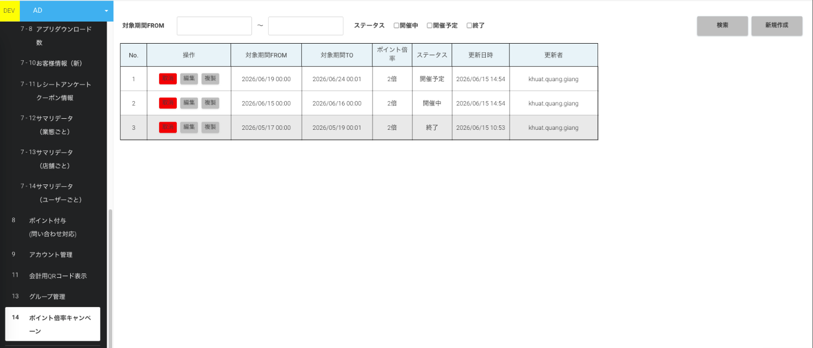
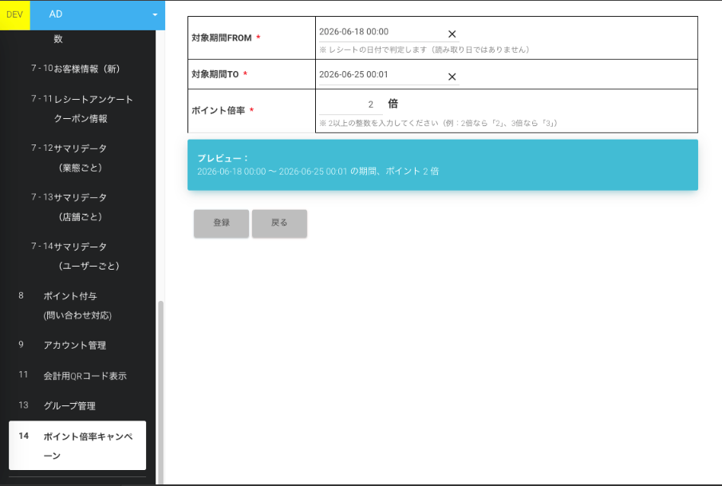
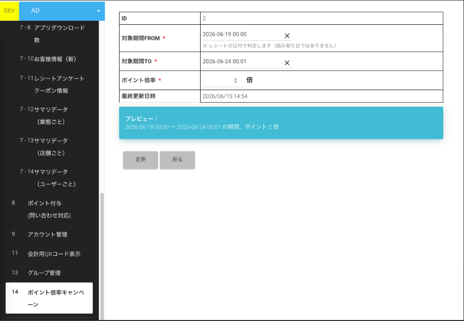

# 📋 Phân Tích Requirement: DEV_ON_APP-4939
## 「CMS」Chiến Dịch Nhân Hệ Số Điểm (ポイント倍率キャンペーン)

---

## 1. Tổng Quan Ticket

| Thuộc tính | Giá trị |
|---|---|
| **Ticket ID** | DEV_ON_APP-4939 |
| **Tiêu đề** | 「CMS」ポイント○○倍キャンペーン — Chiến dịch nhân hệ số tích điểm |
| **Nguồn tài liệu** | 「CMS」ポイント○○倍キャンペーン_Chiến dịch nhân hệ số điểm.xlsx |
| **Backlog** | https://zhdoa.backlog.jp/view/DEV_ON_APP-4939 |
| **Scope phân tích** | Logic tích điểm theo hệ số (ポイント倍率ロジック) |
| **Áp dụng cho** | Toàn bộ brand |
| **Ảnh hưởng** | CMS (quản lý chiến dịch) + App (scan QR tích điểm) + CMS Claim (màn hình 8 ポイント付与) |

---

## 1A. Phân Tách 2 Luồng Nghiệp Vụ

> **Tài liệu spec này bao gồm 2 luồng riêng biệt. Phân tích này TẬP TRUNG vào Luồng 2 — luồng user tích điểm.**

| Luồng | Tên | Mô tả | Actor | Phạm vi phân tích này |
|---|---|---|---|---|
| **Luồng 1** | Quản lý chiến dịch (CMS) | Admin tạo / sửa / xóa / lưu nháp campaign (FROM, TO, Hệ số). Bao gồm validate overlap, chuyển trạng thái, hiển thị list. | CMS Admin | ⬜ Không phải trọng tâm phân tích này |
| **Luồng 2** | User tích điểm bằng QR scan | User ăn tại cửa hàng → nhận hóa đơn → scan QR → hệ thống tính điểm (có hoặc không nhân hệ số tùy ngày HĐ so với campaign) | App User | ✅ **TRỌNG TÂM PHÂN TÍCH** |

**Mối liên hệ giữa 2 luồng (flow từ đầu đến cuối):**

| Bước | Actor | Hành động |
|---|---|---|
| 1 | CMS Admin (Luồng 1) | Cấu hình campaign: FROM, TO, ポイント倍率 → publish lên hệ thống |
| 2 | Hệ thống | Lưu trữ campaign với trạng thái tương ứng (開催前 / 開催中 / 終了) |
| 3 | App User (Luồng 2) | Ăn tại cửa hàng → nhận hóa đơn có ngày phát hành **T_invoice** |
| 4 | App User (Luồng 2) | Scan QR hóa đơn tại thời điểm **T_scan** (trong vòng 7 ngày kể từ T_invoice) |
| 5 | Backend | Check: **T_invoice** có nằm trong khoảng FROM~TO của campaign đang ACTIVE (không phải Draft / Deleted) không? |
| 6 | Backend | **CÓ** → Điểm = Base × Hệ số campaign / **KHÔNG** → Điểm = Base (bình thường) |

---

## 2. User Story

> **Là một** quản trị viên cửa hàng (shop admin),
> **Tôi muốn** tạo và quản lý chiến dịch nhân hệ số tích điểm trên CMS,
> **Để có thể** khuyến khích khách hàng đến cửa hàng trong khoảng thời gian nhất định, và khách hàng tự động nhận được điểm nhân hệ số (x2, x3, ...) khi quét tích điểm hóa đơn phát hành trong thời gian chiến dịch.

---

## 3. Phạm Vi Áp Dụng (Scope)

| # | Module/Màn hình | Thay đổi | Ghi chú |
|---|---|---|---|
| 1 | CMS — Menu | Thêm mục menu mới | **14 ポイント倍率キャンペーン** |
| 2 | CMS — Màn hình danh sách chiến dịch | Tạo mới | List + Filter theo trạng thái |
| 3 | CMS — Màn hình đăng ký chiến dịch | Tạo mới | Form tạo mới campaign |
| 4 | CMS — Màn hình edit chiến dịch | Tạo mới | Form chỉnh sửa campaign |
| 5 | App — QR Scan tích điểm | Sửa đổi logic | Áp dụng hệ số nếu có campaign đang chạy |
| 6 | CMS — Màn hình 8 (ポイント付与 — Claim) | Sửa đổi logic | Áp dụng hệ số tương ứng campaign |

---

## 4. Acceptance Criteria — Phân Tích Chi Tiết

### 4.1. Thông Tin Cấu Hình Chiến Dịch (Campaign Fields)

| # | Tên field (JP) | Tên field (VN) | Kiểu dữ liệu | Ràng buộc | Ghi chú |
|---|---|---|---|---|---|
| 1 | 対象期間FROM | Thời điểm bắt đầu | Datetime (ngày giờ) | Bắt buộc | Chọn tới mức giờ phút |
| 2 | 対象期間TO | Thời điểm kết thúc | Datetime (ngày giờ) | Bắt buộc | Chọn tới mức giờ phút |
| 3 | ポイント倍率 | Hệ số điểm | Số nguyên | Bắt buộc; Chỉ nhập số nguyên từ **2 đến 99** | Không chấp nhận thập phân, số âm, 0, 1 |

**Lưu ý:** Không có field tên/tiêu đề campaign. Vì tại một thời điểm chỉ có tối đa 1 campaign, nên không cần tên để phân biệt (confirmed Q&A #3).

---

### 4.2. Logic Tính Điểm Theo Hệ Số — Luồng 2: User Tích Điểm

> **⚠️ TRỌNG TÂM PHÂN TÍCH:** Luồng CMS (Luồng 1) chỉ là công cụ cấu hình. Giá trị kiểm thử thực sự nằm ở việc hệ thống phán định **đúng** khi nào user được nhân hệ số — dựa trên tổ hợp timing giữa ngày phát hành hóa đơn và thời gian campaign.

#### 4.2.1. Công thức tính điểm

    Point nhận được = Điểm thực tế (base point) × Hệ số của chiến dịch (ポイント倍率)

| Ví dụ | Base Point | Hệ số | Point nhận được |
|---|---|---|---|
| Campaign x2 | 100 | 2 | 200 |
| Campaign x3 | 150 | 3 | 450 |
| Không có campaign | 100 | — | 100 (giữ nguyên) |

#### 4.2.2. Quy Tắc Phán Định — Cốt Lõi

> **Hệ thống xác định hệ số dựa trên: Ngày phát hành hóa đơn (T_invoice) — KHÔNG phải ngày quét (T_scan).**
>
> Logic backend: *"Vào ngày T_invoice, có campaign nào đang ACTIVE (không phải Draft, không phải Deleted) không?"*
> - **CÓ** → nhân hệ số của campaign đó
> - **KHÔNG** → tính điểm bình thường (× 1)

**Ràng buộc vật lý của luồng tích điểm (không thể vi phạm):**

| Ràng buộc | Diễn giải |
|---|---|
| T_scan ≥ T_invoice | Không thể quét trước khi hóa đơn được phát hành |
| T_scan ≤ T_invoice + 7 ngày | QR hóa đơn chỉ có hiệu lực 7 ngày kể từ ngày phát hành (API spec) |

#### 4.2.3. Ma Trận Đầy Đủ — Tổ Hợp Thời Điểm Phát Hành HĐ × Thời Điểm Quét

**Ký hiệu:** Campaign chạy từ **T_start** đến **T_end**

| # | Ngày phát hành HĐ (T_invoice) | Ngày quét (T_scan) | Khả thi? | Kết quả | Nguồn xác nhận |
|---|---|---|---|---|---|
| SC-01 | TRƯỚC campaign (< T_start) | Trước campaign (< T_start) | ✅ Có thể | ❌ Không nhân hệ số | Quy tắc gốc |
| SC-02 | TRƯỚC campaign (< T_start) | TRONG campaign (T_start ~ T_end) | ✅ Có thể (nếu HĐ phát hành trong vòng 7 ngày trước T_start) | ❌ Không nhân hệ số | Quy tắc gốc — T_invoice không thuộc campaign |
| SC-03 | TRƯỚC campaign (< T_start) | SAU campaign (> T_end) | ✅ Có thể (campaign ngắn, HĐ còn hiệu lực) | ❌ Không nhân hệ số | Quy tắc gốc |
| SC-04 | TRONG campaign (T_start ≤ T_invoice ≤ T_end) | TRONG campaign (T_start ~ T_end) | ✅ Có thể | ✅ Nhân hệ số | Spec chính |
| SC-05 | TRONG campaign (T_start ≤ T_invoice ≤ T_end) | SAU campaign (> T_end) | ✅ Có thể (QR còn hiệu lực ≤ 7 ngày từ T_invoice) | ✅ Nhân hệ số | ✅ Confirmed Q&A #6 |
| SC-06 | TRONG campaign | TRƯỚC campaign (< T_start) | ❌ Bất khả thi | N/A | T_scan phải ≥ T_invoice ≥ T_start — mâu thuẫn logic |
| SC-07 | SAU campaign (> T_end) | SAU campaign (> T_end) | ✅ Có thể | ❌ Không nhân hệ số | Quy tắc gốc |
| SC-08 | Bất kỳ — KHÔNG CÓ CAMPAIGN nào tồn tại | Bất kỳ | ✅ Có thể | ❌ Không nhân hệ số | Quy tắc gốc |

> **SC-02 — Case quan trọng nhất cần test:** User ăn 3 ngày TRƯỚC khi campaign bắt đầu, sau đó đem hóa đơn vào quét KHI campaign đang chạy → hệ thống phải **KHÔNG** nhân hệ số (vì T_invoice < T_start). Đây là case dễ bị dev implement sai nhất.

> **SC-05 — Case đã confirmed (Q&A #6):** User ăn ngày cuối của campaign, quét hóa đơn 2 ngày sau khi campaign đã kết thúc → hệ thống phải **CÓ** nhân hệ số (vì T_invoice nằm trong campaign).

#### 4.2.4. Edge Case — Trạng Thái Campaign Thay Đổi Giữa Lúc Phát Hành HĐ Và Quét

| # | Tình huống | Kết quả | Nguồn xác nhận |
|---|---|---|---|
| EC-01 | HĐ phát hành khi campaign ACTIVE → Campaign bị **xóa** → User quét sau khi xóa | ❌ Không nhân hệ số (campaign đã xóa → không áp dụng) | ✅ Confirmed Q&A #2 |
| EC-02 | User đã quét và tích điểm ×2 → Admin xóa campaign sau đó | ✅ Điểm cũ **giữ nguyên** (không rollback) | ✅ Confirmed Q&A #2 |
| EC-03 | HĐ phát hành khi campaign đang x2 → Admin **edit hệ số** thành x3 → User quét | ❓ Hệ số tại thời điểm quét: x2 (lúc phát hành HĐ) hay x3 (hệ số mới)? | ⚠️ Chưa rõ (AMB-11) |
| EC-04 | HĐ phát hành khi campaign ACTIVE → Admin **edit FROM/TO** (T_invoice không còn nằm trong range mới) → User quét | ❓ Có nhân hệ số không? | ⚠️ Chưa rõ (AMB-12) |
| EC-05 | HĐ phát hành **đúng tại T_start** (boundary) | ❓ Inclusive hay exclusive? (FROM = T_start có được tính không?) | ⚠️ Cần confirm (AMB-13) |
| EC-06 | HĐ phát hành **đúng tại T_end** (boundary) | ❓ Inclusive hay exclusive? (TO = T_end có được tính không?) | ⚠️ Cần confirm (AMB-13) |
| EC-07 | HĐ trong campaign nhưng QR đã **hết hiệu lực** (> 7 ngày từ phát hành) khi quét | N/A — QR không hợp lệ, tích điểm thất bại | API spec |

#### 4.2.5. Kênh Áp Dụng Hệ Số Điểm

| Kênh | Mô tả | Áp dụng hệ số? | Cơ sở phán định ngày |
|---|---|---|---|
| QR Scan tích điểm (App) | User quét QR hóa đơn sau khi ăn | ✅ Có | Ngày phát hành hóa đơn (T_invoice) |
| Claim — ポイント付与 (CMS màn hình 8) | Admin cấp điểm thủ công | ✅ Có (spec nêu rõ) | ❓ Ngày phát hành HĐ hay ngày admin thực hiện claim? (AMB-04) |

**Lưu ý:** QR hóa đơn chỉ có hiệu lực trong **7 ngày** kể từ ngày phát hành (từ API spec).

---

### 4.3. Quy Tắc Không Trùng Lặp Thời Gian (Overlap Prevention)

> **Quy tắc cốt lõi:** Tại một thời điểm bất kỳ, chỉ có tối đa 1 campaign đang hoạt động. Không được phép tạo campaign mới nếu khoảng thời gian trùng với campaign đã tồn tại.

#### 4.3.1. Các trường hợp overlap bị từ chối (NG)

Giả sử đã có: **Campaign 1: 2026/07/13 10:00 ~ 2026/08/13 23:59**

| Campaign mới | FROM | TO | Lý do NG |
|---|---|---|---|
| Campaign 2 | 2026/07/15 10:00 | 2026/08/13 23:59 | Nằm trong Campaign 1 (trùng end) |
| Campaign 3 | 2026/07/13 10:00 | 2026/08/09 23:59 | Nằm trong Campaign 1 (trùng start) |
| Campaign 4 | 2026/07/15 | 2026/08/09 | Hoàn toàn nằm trong Campaign 1 |
| Campaign 5 | 2026/07/15 | 2026/08/15 | Chồng lấp phần đầu/cuối Campaign 1 |
| Campaign 6 | 2026/07/10 | 2026/08/08 | Bắt đầu trước, kết thúc trong Campaign 1 |

**Kết luận:** Bất kỳ dạng chồng lấp nào cũng đều bị từ chối (full-overlap, partial-overlap, contained).

#### 4.3.2. Trạng thái cần kiểm tra overlap

| Trạng thái (JP) | Trạng thái (VN) | Có check overlap? |
|---|---|---|
| 開催中 | Đang diễn ra | ✅ Có |
| 開催前 | Chuẩn bị diễn ra | ✅ Có |
| 終了 | Đã kết thúc | ✅ Có |
| 一時保存 | Bản nháp (Draft) | ❌ Không check (confirmed Q&A #1) |
| 取消済 | Đã xóa (Deleted) | ❌ Không check (confirmed Q&A #5) |

> **Lý do:** Trạng thái Draft hoạt động tương tự chức năng tạo bản nháp coupon hiện tại — không validate overlap khi lưu draft, chỉ validate khi publish bản chính thức.

---

### 4.4. Vòng Đời Chiến Dịch & Trạng Thái

#### 4.4.1. Danh sách trạng thái

| # | Trạng thái (JP) | Trạng thái (VN) | Mô tả |
|---|---|---|---|
| 1 | 開催中 | Đang diễn ra | Hiện tại nằm trong khoảng FROM~TO |
| 2 | 開催前 | Chuẩn bị diễn ra | FROM > thời điểm hiện tại |
| 3 | 一時保存 | Bản nháp | Chưa publish |
| 4 | 取消済 | Đã xóa | Đã bị xóa/hủy |
| 5 | 終了 | Đã kết thúc | TO < thời điểm hiện tại |

> **Lưu ý:** Spec ghi "4 trạng thái" nhưng thực tế liệt kê 5 → cần xác nhận lại với PO/BA.

#### 4.4.2. Hành vi Edit/Delete theo trạng thái

| Trạng thái | Có thể Edit? | Có thể Delete? | Ghi chú |
|---|---|---|---|
| 開催中 (Đang diễn ra) | ✅ Có (kể cả edit time quá khứ/tương lai) | ✅ Có (kèm cảnh báo) | Cảnh báo: 「選択中のキャンペーンは現在開催中です。削除してもよろしいですか。」 |
| 開催前 (Sắp diễn ra) | ✅ Có | ✅ Có | Không có cảnh báo đặc biệt (cần xác nhận) |
| 一時保存 (Bản nháp) | ✅ Có | ✅ Có | — |
| 終了 (Kết thúc) | ? | ? | Chưa rõ (AMB-01) |
| 取消済 (Đã xóa) | ❌ Không | — | Campaign đã xóa thì không áp dụng hệ số điểm |

#### 4.4.3. Hành vi sau khi Delete campaign

| Tình huống | Kết quả |
|---|---|
| User đã tích điểm x2 trước khi admin xóa campaign | Điểm cũ **giữ nguyên** (không rollback) |
| User quét tích điểm sau khi campaign đã bị xóa | **Không nhân hệ số** (dù thời gian của campaign vẫn còn hiệu lực) |

---

### 4.5. Quy Tắc Tạo Chiến Dịch

| # | Quy tắc | Chi tiết |
|---|---|---|
| 1 | Hệ số điểm (ポイント倍率) | Chỉ nhập số nguyên từ **2 đến 99**. Không chấp nhận: 1, 0, số âm, số thập phân |
| 2 | Thời gian tạo | Có thể tạo campaign ở thời điểm quá khứ, hiện tại, hoặc tương lai |
| 3 | Không cần tên campaign | Vì mỗi thời điểm chỉ có 1 campaign duy nhất |
| 4 | Validate overlap | Chỉ khi save thành bản chính thức (không validate khi lưu draft) |

---

### 4.6. Hiển Thị Màn Hình Danh Sách

| # | Tính năng | Chi tiết |
|---|---|---|
| 1 | Sắp xếp | Theo ngày tạo mới nhất lên đầu |
| 2 | Filter mặc định | Hiển thị: **開催中**, **開催前**, **一時保存** |
| 3 | Filter theo trạng thái | Có thể lọc theo tất cả trạng thái |

---

## 5. Phụ Thuộc (Dependencies)

| # | Ticket | Mô tả | Liên quan |
|---|---|---|---|
| 1 | DEV_ON_APP-4939 | Backlog ticket chính | Ticket gốc |
| 2 | Màn hình 8 ポイント付与 (CMS Claim) | Chức năng cấp điểm thủ công | Cần sửa đổi logic để áp dụng hệ số campaign |
| 3 | Chức năng QR Scan tích điểm (App) | Chức năng tích điểm bằng QR code | Cần sửa đổi logic tính điểm |

---

## 6. Phân Tích Mockup/Screenshot

### 6.1. Màn Hình Danh Sách (image1.png — rows 53-78 trong spec)

**Mô tả:**
- Menu mới: **14 ポイント倍率キャンペーン**
- Hiển thị danh sách các campaign với thứ tự: mới nhất lên đầu
- Có filter theo trạng thái; filter mặc định: 開催中, 開催前, 一時保存
- Các cột hiển thị: dự kiến bao gồm FROM, TO, Hệ số, Trạng thái, Ngày tạo, Actions (Edit/Delete)

### 6.2. Màn Hình Đăng Ký (image2.png — rows 80-111 trong spec)

**Mô tả:**
- Form tạo mới campaign
- Fields: 対象期間FROM (datetime picker), 対象期間TO (datetime picker), ポイント倍率 (input số nguyên)
- Buttons: Lưu bản nháp (一時保存), Đăng ký chính thức

### 6.3. Màn Hình Edit (image3.png — rows 80-112 trong spec)

**Mô tả:**
- Tương tự màn hình đăng ký, nhưng hiển thị dữ liệu hiện tại để chỉnh sửa
- Campaign ở trạng thái 開催中 vẫn có thể edit (kể cả sửa thời gian quá khứ/tương lai)

---

## 7. Các Điểm Mơ Hồ & Rủi Ro

### 7.1. Điểm Mơ Hồ (Ambiguities)

| # | Câu hỏi | Nguy cơ nếu không rõ | Mức độ |
|---|---|---|---|
| AMB-01 | Spec ghi "4 trạng thái" nhưng liệt kê 5 (開催中, 開催前, 一時保存, 取消済, 終了). Số lượng chính xác là bao nhiêu? | Sai sót trong test coverage, bỏ sót test case cho 1 trạng thái | 🔴 High |
| AMB-02 | Campaign ở trạng thái **終了** và **取消済** có thể Edit/Delete không? Spec chỉ đề cập 開催中 được edit/delete | Không clear behavior khi user thao tác trên các trạng thái này | 🔴 High |
| AMB-03 | Khi Delete campaign đang chạy (開催中): điểm cũ của user có rollback không? (Q&A #2 có đề cập nhưng phần trả lời bị cắt ngắn, chỉ có "Ngoài ra cần đảm bảo..." — thiếu câu trả lời trực tiếp về rollback) | Không rõ behavior khi xóa campaign — ảnh hưởng tới user data integrity | 🔴 High |
| AMB-04 | Màn hình Claim (ポイント付与 — CMS màn hình 8): cách phán định ngày nào để check campaign? Ngày phát hành hóa đơn hay ngày admin cấp điểm? | Logic claim có thể khác với logic QR scan | 🔴 High |
| AMB-05 | QR hóa đơn chỉ có hiệu lực **7 ngày**. Nếu campaign kết thúc trước khi user quét nhưng hóa đơn vẫn còn hiệu lực, có áp dụng hệ số không? (Q&A #6 đã xác nhận: dựa vào ngày phát hành — nhưng cần test case cụ thể để confirm) | Risk bỏ sót test case biên | 🟡 Medium |
| AMB-06 | Khi Edit campaign 開催中: Nếu sửa ngày FROM/TO thành khoảng thời gian mới có overlap với campaign khác, có bị validate không? | Lỗi data consistency — nhiều campaign trùng nhau | 🔴 High |
| AMB-07 | Filter danh sách: có thể chọn nhiều trạng thái cùng lúc không? Hay chỉ chọn 1 trạng thái? | Ảnh hưởng đến test case cho filter | 🟡 Medium |
| AMB-08 | Màn hình list: ngoài thứ tự ngày tạo, có pagination không? Khi số lượng campaign lớn hiển thị như thế nào? | Thiếu test coverage cho performance/pagination | 🟢 Low |
| AMB-09 | ポイント倍率 = 1 có được nhập không? Spec ghi "từ 2-99" → validate error message là gì? | Thiếu test case validation | 🟡 Medium |
| AMB-10 | Campaign đã 終了 có bị check overlap khi tạo campaign mới không? (Q&A #5 xác nhận: trừ Draft và Deleted thì các trạng thái còn lại đều cần check → bao gồm 終了) Nhưng logic này có vẻ không hợp lý với business | Có thể gây phức tạp khi tạo campaign mới trong khoảng thời gian quá khứ | 🟡 Medium |
| AMB-11 | **[EC-03 — Luồng 2]** Khi admin **edit hệ số** của campaign đang chạy (VD: đổi x2 → x3), hóa đơn đã phát hành trong campaign nhưng user chưa quét sẽ nhận hệ số x2 (tại thời điểm phát hành) hay x3 (hệ số mới khi quét)? | Ảnh hưởng trực tiếp tới số điểm user nhận được — có thể bất công với user | 🔴 High |
| AMB-12 | **[EC-04 — Luồng 2]** Khi admin **edit FROM/TO** của campaign đang chạy, thu hẹp range (VD: TO từ 08/20 thành 08/10), hóa đơn phát hành ngày 08/15 (trong range cũ, ngoài range mới) → User quét: có nhân hệ số không? | User có thể bị mất điểm nhân hệ số không mong muốn do admin chỉnh campaign | 🔴 High |
| AMB-13 | **[EC-05/06 — Luồng 2]** Boundary của FROM và TO: hóa đơn phát hành **đúng tại thời điểm T_start** hoặc **đúng T_end** có được tính vào campaign không? (Inclusive hay Exclusive?) | Ảnh hưởng tới test case biên — sai 1 giây là sai kết quả | 🟡 Medium |
| AMB-14 | **[Luồng 2 — tổng hợp EC-03+04]** Khi admin edit campaign đang chạy, hệ thống có ghi log snapshot tại thời điểm phát hành HĐ để dùng cho phán định sau (khi user quét), hay chỉ dùng trạng thái campaign hiện tại tại thời điểm quét? | Ảnh hưởng tới toàn bộ cách backend implement logic phán định | 🔴 High |

### 7.2. Rủi Ro Kiểm Thử

| # | Tên rủi ro | Mô tả | Mitigation |
|---|---|---|---|
| RISK-01 | Logic phán định ngày phát hành ≠ ngày quét | Backend có thể nhầm dùng ngày quét thay vì ngày phát hành hóa đơn để check campaign | Test case: quét sau khi campaign kết thúc nhưng hóa đơn phát hành trong campaign → phải được x hệ số |
| RISK-02 | Deleted campaign vẫn áp dụng hệ số | Nếu backend không xử lý đúng, campaign đã xóa vẫn nhân điểm | Test case: xóa campaign → quét tích điểm với hóa đơn trong khoảng thời gian đã xóa → không được nhân hệ số |
| RISK-03 | Overlap validation không đầy đủ | Chỉ check 1 chiều (FROM mới nằm giữa FROM-TO cũ) mà bỏ sót các dạng overlap khác | Test đủ 6 dạng overlap như spec mô tả |
| RISK-04 | Đồng thời tạo campaign (race condition) | Hai admin tạo campaign cùng lúc có thể bypass overlap validation | Test concurrency; API cần có lock |
| RISK-05 | Edit campaign đang 開催中 thay đổi hệ số | Điểm đang được tích lũy, nếu đổi hệ số giữa chừng ảnh hưởng tới hóa đơn chưa quét | Cần xác nhận: thay đổi hệ số của campaign đang chạy có ảnh hưởng retroactive không |
| RISK-06 | Claim (ポイント付与) không áp dụng đúng hệ số | Logic claim được nhắc đến nhưng không được spec chi tiết | Cần test riêng luồng claim với campaign đang chạy |
| RISK-07 | Hệ số điểm ngoài range 2-99 | Nhập các giá trị biên và ngoài biên: 1, 100, 0, -1, ký tự đặc biệt | Test validation đầy đủ |
| RISK-08 | Hiển thị trạng thái tự động cập nhật | Khi campaign chuyển từ 開催前 → 開催中 → 終了 theo thời gian thực, UI có cập nhật không? | Test scheduled status transition |
| RISK-09 | **[Luồng 2]** Backend dùng ngày quét thay vì ngày phát hành HĐ | Dev có thể nhầm implement: dùng T_scan thay vì T_invoice để check campaign → SC-02 sẽ sai (hóa đơn cũ nhưng quét trong campaign lại được nhân hệ số) và SC-05 sẽ sai (hóa đơn trong campaign nhưng quét sau khi hết → không được nhân) | Test case ưu tiên: SC-02 và SC-05 |
| RISK-10 | **[Luồng 2]** Edit hệ số giữa chừng gây sai điểm (EC-03) | Admin đổi hệ số campaign đang chạy → user cầm hóa đơn chưa quét nhận điểm sai so với mong đợi | Cần spec rõ: hệ số tại thời điểm phát hành HĐ hay thời điểm quét |
| RISK-11 | **[Luồng 2]** Edit FROM/TO ảnh hưởng hóa đơn pending (EC-04) | Admin thu hẹp thời gian campaign → các hóa đơn đã phát hành nhưng chưa quét không còn được nhân hệ số | Cần spec rõ hành vi khi edit time range có hóa đơn đang pending |

---

## 8. Ma Trận Trạng Thái (State × Behavior Matrix)

| Trạng thái | Check Overlap | Edit | Delete | Áp dụng hệ số điểm | Hiển thị trong filter mặc định |
|---|---|---|---|---|---|
| 開催中 (Đang diễn ra) | ✅ | ✅ (có cảnh báo) | ✅ (có cảnh báo xác nhận) | ✅ | ✅ |
| 開催前 (Sắp diễn ra) | ✅ | ✅ | ✅ | ❌ (chưa đến giờ) | ✅ |
| 終了 (Đã kết thúc) | ✅ | ? (AMB-02) | ? (AMB-02) | ❌ (đã qua) | ❌ |
| 一時保存 (Bản nháp) | ❌ | ✅ | ✅ | ❌ | ✅ |
| 取消済 (Đã xóa) | ❌ | ❌ | — | ❌ | ❌ |

---

## 9. Tóm Tắt Acceptance Criteria (Checklist)

### Nhóm 1: Cấu hình chiến dịch (Campaign Setup)
- [ ] AC-01: Có thể tạo chiến dịch mới với 3 fields: FROM (datetime), TO (datetime), Hệ số (integer 2-99)
- [ ] AC-02: ポイント倍率 chỉ chấp nhận số nguyên từ 2 đến 99; từ chối: 1, 0, số âm, số thập phân, ký tự
- [ ] AC-03: Có thể tạo chiến dịch ở bất kỳ thời điểm nào: quá khứ, hiện tại, tương lai
- [ ] AC-04: Không có field tên/tiêu đề campaign

### Nhóm 2: Logic tính điểm
- [ ] AC-05: Điểm nhận = Base point × Hệ số khi hóa đơn phát hành nằm trong khoảng thời gian campaign
- [ ] AC-06: Phán định dựa trên **ngày phát hành hóa đơn**, không phải ngày quét
- [ ] AC-07: Quét sau khi campaign kết thúc nhưng hóa đơn phát hành trong campaign → vẫn nhân hệ số
- [ ] AC-08: Hóa đơn phát hành ngoài campaign → tính điểm bình thường (không nhân hệ số)
- [ ] AC-09: Logic hệ số áp dụng cho cả QR Scan và Claim (ポイント付与)

### Nhóm 3: Ngăn chặn trùng thời gian (Overlap Prevention)
- [ ] AC-10: Không thể tạo campaign mới nếu thời gian trùng với campaign ở trạng thái 開催中, 開催前, hoặc 終了
- [ ] AC-11: Có thể lưu bản nháp (一時保存) dù thời gian trùng với campaign khác
- [ ] AC-12: Campaign đã 取消済 không bị tính khi check overlap
- [ ] AC-13: Từ chối tất cả dạng overlap: full-contain, partial-start, partial-end, same-start, same-end

### Nhóm 4: Vòng đời & Trạng thái
- [ ] AC-14: Chiến dịch có 5 trạng thái: 開催中, 開催前, 一時保存, 取消済, 終了
- [ ] AC-15: Campaign 開催中 vẫn có thể edit (kể cả sửa ngày quá khứ/tương lai)
- [ ] AC-16: Khi xóa campaign 開催中, hiển thị confirm dialog với nội dung: 「選択中のキャンペーンは現在開催中です。削除してもよろしいですか。」
- [ ] AC-17: Campaign đã xóa (取消済) không áp dụng hệ số điểm dù thời gian vẫn còn hiệu lực
- [ ] AC-18: Điểm đã tích trước khi campaign bị xóa không bị rollback

### Nhóm 5: Màn hình danh sách
- [ ] AC-19: Có menu mới: 14 ポイント倍率キャンペーン
- [ ] AC-20: Danh sách sắp xếp theo ngày tạo mới nhất lên đầu
- [ ] AC-21: Có filter theo trạng thái; mặc định hiển thị: 開催中, 開催前, 一時保存

---

## 10. Khuyến Nghị Cho Kiểm Thử

> *Đây là gợi ý ưu tiên kiểm thử, KHÔNG phải test cases.*

1. **Ưu tiên #1 — Test biên ngày phát hành hóa đơn**: Tập trung vào boundary của campaign period:
   - Hóa đơn phát hành đúng 1 giây trước FROM → không nhân hệ số
   - Hóa đơn phát hành đúng thời điểm FROM → nhân hệ số
   - Hóa đơn phát hành đúng thời điểm TO → nhân hệ số
   - Hóa đơn phát hành đúng 1 giây sau TO → không nhân hệ số

2. **Ưu tiên #2 — Test toàn bộ 6 dạng overlap**: Dựa theo ví dụ trong spec (Campaign 2~6), đảm bảo mọi dạng chồng lấp đều bị từ chối khi tạo campaign mới

3. **Ưu tiên #3 — Test scan sau khi campaign kết thúc**: Hóa đơn phát hành trong campaign, quét SAU khi campaign kết thúc → phải được nhân hệ số (confirmed Q&A #6)

4. **Ưu tiên #4 — Test Delete campaign đang chạy**: Xóa campaign 開催中 → confirm dialog → sau khi xóa, quét hóa đơn phát hành trong khoảng thời gian đó → không nhân hệ số

5. **Ưu tiên #5 — Test validate ポイント倍率**: Test biên: 1 (NG), 2 (OK), 99 (OK), 100 (NG), 0 (NG), -1 (NG), 2.5 (NG), chữ "abc" (NG)

6. **Ưu tiên #6 — Test Draft không check overlap**: Lưu bản nháp với thời gian trùng → được phép lưu; Publish bản nháp với thời gian trùng → bị từ chối

7. **Ưu tiên #7 — Test trạng thái 終了 và overlap**: Campaign đã kết thúc vẫn cần check overlap → cần xác nhận business logic với PO trước khi test

8. **Ưu tiên #8 — Test claim (ポイント付与)**: Spec đề cập nhưng không chi tiết — cần clarify flow trước khi test

9. **Ưu tiên #9 — Test edit campaign 開催中 đổi hệ số**: Sau khi đổi hệ số, hóa đơn mới quét nhận hệ số mới; hóa đơn đã quét trước đó không bị ảnh hưởng

10. **Ưu tiên #10 — Test concurrent campaign creation**: Hai admin tạo campaign cùng khoảng thời gian cùng lúc → chỉ 1 trong 2 được phép tạo

---

*Tài liệu phân tích này tập trung vào logic tích điểm theo hệ số. Khi cần sinh test cases chi tiết, sử dụng workflow /generate_manual_testcases_rbt.*

*Nguồn: 「CMS」ポイント○○倍キャンペーン_Chiến dịch nhân hệ số điểm.xlsx — Sheets: 02 Specs, 03 Q&A, 04 Điều Tra API CMS*

*Phân tích bởi: GitHub Copilot — 2026-07-20*
